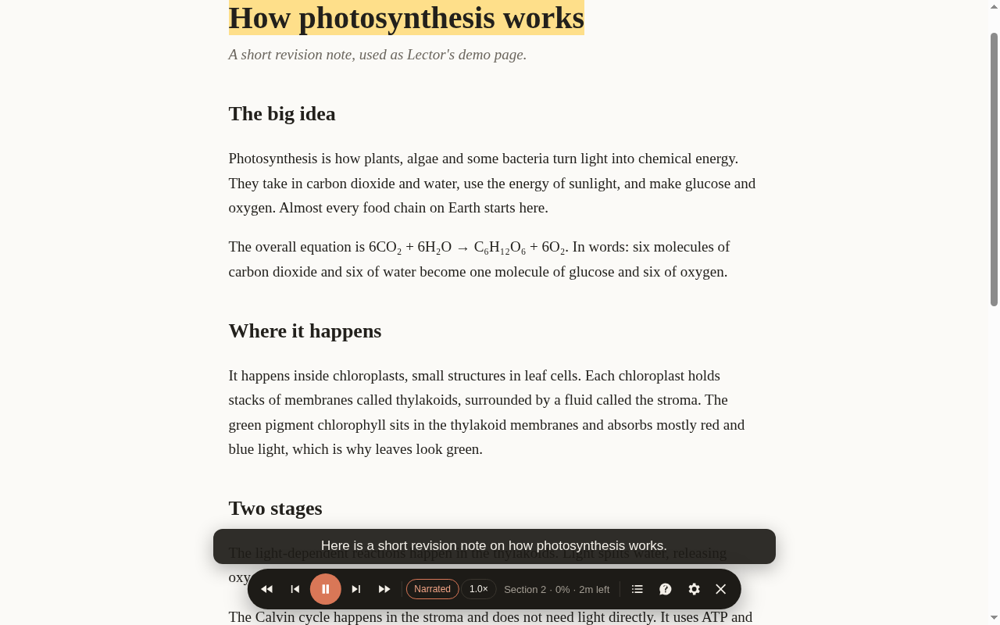

<p align="center"></p>
<h1 align="center">Lector</h1>
<p align="center"><b>Study by listening. Ask when you get lost.</b><br>
A free Chrome extension that reads web pages and PDFs aloud in a natural voice, explains slides like a tutor,<br>
and answers your questions out loud when you pause it.</p>
<p align="center"><a href="https://shinzuu.github.io/lector/">Website</a> ·
<a href="https://github.com/Shinzuu/lector/releases/latest/download/lector.zip">Download</a> ·
<a href="#set-up">Set up</a> · <a href="#use">Use</a> · <a href="#privacy">Privacy</a></p>

<p align="center"></p>

## What it does

- **Reads anything aloud:** any web page, or any PDF in Lector's own viewer, with the current line highlighted and a caption.
- **Narrated mode:** each slide or section is rewritten as a short spoken explanation. Bullets become sentences, formulas are said in words, and headers, footers, names and page numbers are left out.
- **Pause and ask:** press `A`, ask out loud, hear the answer, then say "continue".
- **Sections:** skip slides or headings, jump around, and see how long is left.
- **Natural voices:** Microsoft's neural voices (Ava, Andrew, Emma, Sonia and more), at 0.8× to 2×.

## Set up

Lector isn't in the Chrome Web Store, so you add it yourself once. Works in Chrome, Edge and Brave.

1. [Download `lector.zip`](https://github.com/Shinzuu/lector/releases/latest/download/lector.zip) and unzip it somewhere you'll keep it. Chrome runs Lector from that folder, so don't delete it.
2. Open `chrome://extensions` and switch on **Developer mode** (top right).
3. Click **Load unpacked** and pick the unzipped `lector` folder (the one with `manifest.json` in it). Pin Lector from the puzzle icon.
4. Get a free Gemini key at [aistudio.google.com/apikey](https://aistudio.google.com/apikey): sign in, click **Create API key**, copy it.
5. Right-click the Lector icon → **Options**, paste the key, click **Save**. Use **Test voice** to pick a voice.
6. For PDFs on your computer: on Lector's card in `chrome://extensions`, click **Details** and turn on **Allow access to file URLs**. Or use **Open PDF** in the viewer.

Reading aloud works without a key; the key adds Narrated mode and questions. An Anthropic API key works too.

## Use

| Key | Does |
|---|---|
| Lector icon or `Alt+Shift+R` | Start or stop. Starts from what's on screen. |
| `Space` | Play / pause |
| `A` | Pause and ask. Speak or type; say "continue" to go on. |
| `S` | Sections: untick to skip, click to jump, see time left |
| `Shift+←` `Shift+→` | Previous / next section (slide or heading) |
| `←` `→` | Previous / next sentence |
| `M` | Narrated / Original |
| right-click → *Lector: read from here* | Start at the selected text |

PDF links open in Lector's viewer, because Chrome's built-in PDF viewer doesn't allow extensions.

Tip: after a chapter, press `A` and say "quiz me on this".

## Privacy

There is no Lector server. Your key is stored only in your browser (`chrome.storage.local`).

- The text being read goes to Microsoft's online voice service to become speech.
- In Narrated mode, and when you ask a question, the nearby text goes to the model you chose (Gemini or Claude). On Gemini's free tier Google may use it to improve its models, so avoid private documents there.
- Spoken questions are transcribed by Chrome's speech recognition (Google).

## Good to know

- The neural voices use the service behind Edge's Read Aloud. That's an unofficial use of a public endpoint (protocol from the open-source [edge-tts](https://github.com/rany2/edge-tts) project). If it ever stops working, Lector switches to Chrome's own voices and says so.
- Narration scripts are cached, so listening again costs no API calls.
- Mispronounced word? Add it in Options under **Pronunciation fixes** (`Kafka = Kaf-ka`).

## Develop

```bash
node --test test/*.test.mjs                  # prompts and provider requests (fetch mocked)
node test/e2e.mjs some.pdf some.html         # headless, muted Chrome: viewer, sections, voice, ask
node test/screenshots.mjs <gemini-key-file>  # regenerates docs/img from docs/demo.html
```

Branded Chrome ignores `--load-extension`, so the tests load Lector over the DevTools protocol
(`--enable-unsafe-extension-debugging`). pdf.js 4.10.38 is vendored in `vendor/pdfjs` (Apache-2.0).

## Licence

MIT. See [LICENSE](LICENSE).
